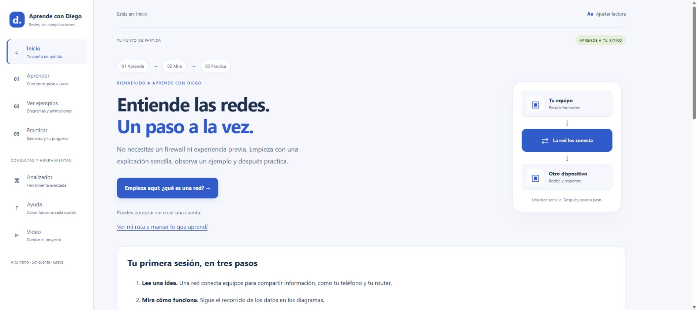
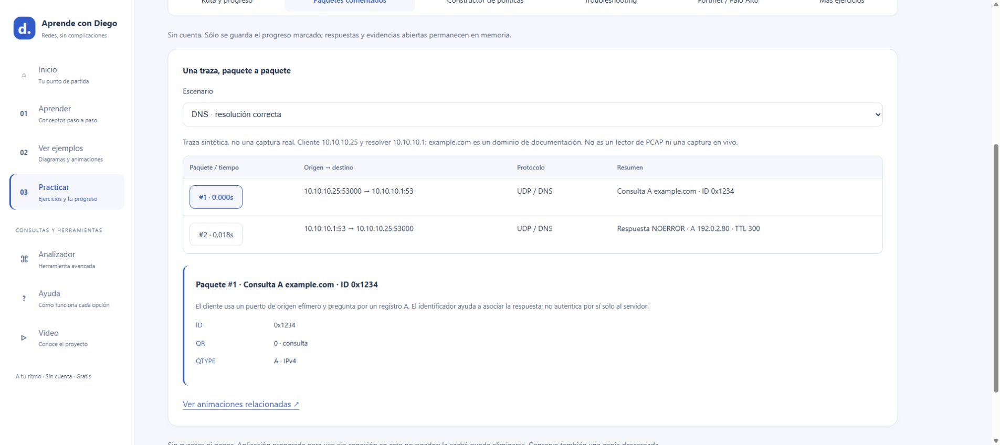
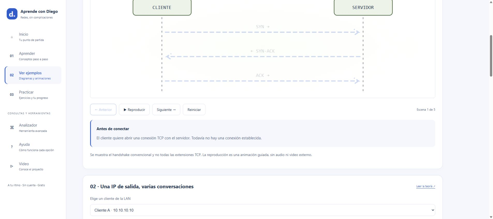
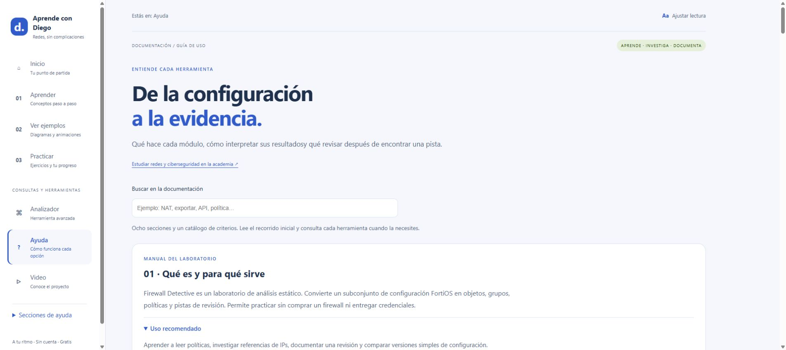
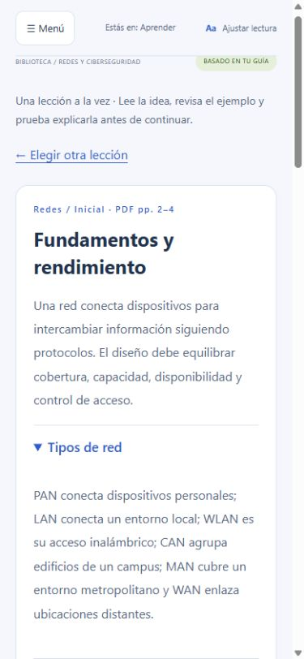

# ◈ Aprende con Diego · Firewall Detective

**Aprende redes, paso a paso.**

[Repositorio](https://github.com/DiegoEsteban20/aprendecondiego) · [Pruebas automáticas](https://github.com/DiegoEsteban20/aprendecondiego/actions)

Plataforma educativa para aprender redes, observar ejemplos y practicar con firewalls **sin hardware ni credenciales**. Incluye una ruta guiada, biblioteca de conceptos y analizador de configuraciones.



**Estado:** v0.2.0 · laboratorio local · subconjunto FortiOS · escenarios sintéticos. PAN-OS y las conexiones a APIs de equipos todavía no están implementados.

## Presentación en un minuto

**Para quién:** estudiantes y profesionales de conectividad, redes y ciberseguridad que quieren aprender con evidencia sin disponer de un firewall físico.

**Qué demuestra el proyecto:** análisis estático educativo, diseño de interfaz, visualización de protocolos, documentación de límites y pruebas reproducibles. **No es una herramienta validada para auditar producción**, no modifica equipos ni interpreta XML PAN-OS.

[Ver demo con video y transcripción](https://diegoesteban20.github.io/aprendecondiego/demo.html) · [Descargar video de 24 segundos](https://diegoesteban20.github.io/aprendecondiego/demo.mp4) · [Plan de pruebas con personas](docs/USER_TESTING.md)

El video es una presentación sin audio de capturas reales con rótulos, no una grabación continua ni una demostración en hardware. Se aloja en el propio proyecto, sin plataformas externas ni pagos. El video conserva el recorrido de la interfaz anterior; las capturas siguientes muestran el diseño actual.

<details><summary>Capturas actuales del analizador, taller, diagramas y ayuda</summary>










</details>

## Acceso libre y procesamiento local

[Abrir la web](https://diegoesteban20.github.io/aprendecondiego/) · [Uso gratuito y sin conexión](docs/FREE_AND_OFFLINE.md)

## Taller Aprende con Diego

[Entrar al taller](https://diegoesteban20.github.io/aprendecondiego/learn.html) · [Manual de las nuevas herramientas](docs/WORKSHOP.md)

Se conserva todo el laboratorio, la academia y las animaciones anteriores. Se añaden ocho módulos de progreso exportable, tres trazas sintéticas comentadas, constructor educativo de intención de políticas, cuatro investigaciones guiadas, nueve comparaciones conceptuales Fortinet/Palo Alto y un repaso de 18 preguntas (las diez originales más ocho nuevas).

Todas las páginas incorporan tema claro/oscuro, texto grande, contraste reforzado y control de animaciones automáticas. El analizador añade notas e informe imprimible mediante el diálogo del navegador, con opción de guardar PDF. Sólo el progreso marcado y las preferencias se guardan en localStorage: configuraciones, respuestas e informes permanecen en memoria hasta exportarlos o imprimirlos. El almacenamiento pertenece al origen y al navegador, no a la carpeta de la URL. Para pasar a otro origen o navegador, importa tu copia JSON.

La interfaz analiza en tu navegador, sin enviar configuraciones a una API. No requiere claves, cuentas ni suscripciones. Incluye caché offline de los archivos públicos del sitio después de una primera carga completa. Conserva también una copia descargada para no depender del alojamiento.

Para actualizar la web: ejecuta `npm run build`, incluye los archivos generados de `docs/` en el commit y publica. GitHub Pages utiliza `main` → `/docs`. La API Node.js es una opción de uso local y no se despliega en Pages.

## Inicio rápido

Requiere **Node.js 22 o posterior**. Sin dependencias de ejecución ni claves de API.

```sh
node server.js
```

Abre **http://127.0.0.1:3000**. En Windows puedes ejecutar `start-windows.cmd`. También se admite `npm start`.

La **[guía integrada](http://127.0.0.1:3000/guide)** explica el propósito de cada herramienta y qué hacer después de un hallazgo. La dirección funciona cuando el servidor está encendido.

## Recorrido inicial

1. Elige **La puerta abierta** y abre el hallazgo `ANY_ANY`.
2. Lee qué detecta, qué significa y qué verificar después. Pulsa **Ver evidencia**.
3. Busca `10.20.0.10` para explorar el objeto, su grupo y las políticas que lo referencian.
4. Cambia `service "ALL"` por `service "HTTPS"` en la política 20 del editor.
5. Analiza y compara contra la versión anterior: revisa el campo modificado.
6. Exporta el reporte JSON del análisis vigente.

Cambiar un criterio no confirma que una política sea segura. El proyecto muestra pistas para revisión y declara lo que no evalúa.

## Herramientas y propósito

**Nuevo: [laboratorio visual](https://diegoesteban20.github.io/aprendecondiego/visuals.html)** con animación controlada de TCP, tabla PAT interactiva, escenarios LAN/DMZ/WAN y recorrido OSI. Funciona sin servicios externos y está incluido en la caché offline. Las escenas son ejemplos educativos independientes del parser; no reemplazan ninguna función existente.

| Herramienta | Para qué sirve |
| --- | --- |
| Tres investigaciones | Practicar exposición aparente, objetos duplicados y referencias ausentes |
| Explorador | Rastrear objetos y grupos que llevan a políticas |
| Búsqueda IPv4 | Encontrar pertenencia a subnet y referencias transitivas |
| Tabla de relaciones | Ver cada referencia explícita y el campo que la contiene |
| Inventario de políticas | Revisar interfaces, direcciones, servicios, acción y estado |
| Hallazgos explicados | Entender criterio, evidencia, prioridad, próximos pasos y límites |
| Editor local | Probar cambios de texto sin tocar un dispositivo |
| Comparación | Detectar cambios de campos y orden relativo de políticas comunes |
| Reporte JSON | Conservar el análisis vigente y sus advertencias |
| Centro de ayuda | Consultar ocho capítulos, conceptos y catálogo de criterios |
| API HTTP propia | Automatizar los análisis desde scripts con JSON |

## Documentación

- **[Manual de uso](docs/USER_GUIDE.md):** instalación, recorrido, módulos, criterios y solución de problemas.
- **[Contrato API](docs/API.md):** rutas, tipos, respuestas, errores y ejemplo en PowerShell.
- **[Arquitectura](docs/ARCHITECTURE.md):** módulos, modelo, algoritmos y decisiones.
- **[Seguridad](SECURITY.md):** datos, controles y límites de operación.
- **[Contribuciones](CONTRIBUTING.md):** cómo extender el proyecto con casos reproducibles.
- **[Validación](docs/VALIDATION.md):** pruebas y alcance de las verificaciones.
- **[Historial](CHANGELOG.md):** cambios de cada versión.
- **[Publicación en GitHub](docs/GITHUB_RELEASE.md):** presentación y pasos para publicar.

La guía en `/guide` no necesita recursos externos y comparte sus explicaciones con el panel de hallazgos.

## Academia de redes y ciberseguridad

Abre **http://127.0.0.1:3000/academy** para estudiar el material adaptado de la *Guía de Redes y Ciberseguridad* de @DiegoMolina, aportada para este proyecto:

- 20 lecciones de redes, seguridad, fabricantes y operación, con búsqueda, filtros, ejemplos y práctica.
- Referencias de puertos y protocolos, comandos por plataforma y glosario.
- Diez preguntas de autoevaluación con explicación y enlace a la lección.
- Páginas de origen por tema, notas de adaptación y referencias primarias.

El PDF original no se distribuye. La academia documenta ambos fabricantes, pero no amplía el soporte del parser a PAN-OS. Los comandos son texto de consulta y no se ejecutan. Consulta [procedencia y criterio editorial](docs/SOURCE_NOTES.md).


## API

| Método | Ruta | Entrada |
| --- | --- | --- |
| GET | `/api/health` | Sin cuerpo |
| GET | `/api/cases` | Sin cuerpo |
| POST | `/api/analyze` | `{ "config": "...", "query": "10.20.0.10" }` |
| POST | `/api/compare` | `{ "before": "...", "after": "..." }` |

POST requiere `Content-Type: application/json`; máximo 1 MB por solicitud. `query` es opcional. Los casos incluyen soluciones porque están diseñados para aprender.

```js
const base = 'http://127.0.0.1:3000';
const cases = await fetch(`${base}/api/cases`).then(response => response.json());
const response = await fetch(`${base}/api/analyze`, {
  method: 'POST',
  headers: { 'Content-Type': 'application/json' },
  body: JSON.stringify({ config: cases[0].config, query: '10.20.0.10' })
});
if (!response.ok) throw new Error(`HTTP ${response.status}`);
console.log((await response.json()).search);
```

## Compatibilidad y límites

Parser educativo para bloques **planos y completos** `config firewall address`, `config firewall addrgrp` y `config firewall policy`, de un único ámbito. Las opciones no evaluadas generan advertencias y se omiten del modelo. Los bloques ajenos, anidamientos, cierres incompletos e identificadores duplicados se rechazan.

La pertenencia a redes sólo interpreta `set subnet` con IPv4 y máscara decimal contigua. No interpreta VDOM, IPv6, FQDN, rangos, exclusiones, VIP/DNAT, perfiles, grupos dinámicos ni sintaxis avanzada de escape. No admite backups completos con otros bloques.

Las heurísticas `ANY_ANY`, `LOG_REVIEW`, `WAN_REVIEW`, `DUPLICATE` y `UNRESOLVED` no calculan conectividad, exposición efectiva, NAT, rutas, horarios o coincidencia de sesiones. Un archivo parcial puede producir referencias ausentes legítimas.

El explorador usa columnas de dependencias y tabla de referencias; no representa una topología física. Las políticas con `all` se listan como contexto universal separado, sin inferir su aplicabilidad.

La comparación semántica sólo evalúa campos interpretados. Informa cambios relativos de orden entre políticas comunes, sin validar su efecto operativo. La comparación textual preserva multiplicidad de líneas, no posiciones.

**No se ha validado contra equipos reales.** No existe afiliación ni certificación de fabricantes.

## Privacidad y ejecución

El servidor escucha en `127.0.0.1`. Procesa en memoria, sin base de datos, telemetría ni llamadas externas. No guarda configuraciones. La página conserva su estado hasta recargar; los reportes descargados permanecen en el disco del usuario y pueden incluir IPs internas, nombres y comentarios.

Usa datos sintéticos al compartir. No incluye autenticación ni controles de una plataforma multiusuario: mantén el servicio local.

## Docker

```sh
docker build -t firewall-detective .
docker run --rm -p 127.0.0.1:3000:3000 firewall-detective
```

El contenedor escucha internamente en todas sus interfaces; el mapeo anterior limita el puerto al loopback del host.

## Desarrollo y pruebas

```sh
node --test
```

Las pruebas cubren heurísticas, referencias transitivas, ciclos, IPv4, estructura, campos omitidos, comparación, contrato HTTP, progreso y referencias del sitio estático. GitHub Actions ejecuta la suite en Node.js 22 y 24. Consulta su resultado por commit en la pestaña Actions; no equivale a validación contra equipos reales.

La navegación común permanece visible sin depender del menú lateral e incorpora un enlace de salto al contenido. Para revisar anchos CSS de 320, 390, 768 y 1280 px abre [la herramienta de desarrollo responsive](https://diegoesteban20.github.io/aprendecondiego/layout-check.html). No sustituye pruebas en un teléfono físico ni una auditoría completa de accesibilidad. El plan de sesiones externas está preparado, pero no se han inventado ni realizado pruebas con personas.

El video ya está incluido: usar el sitio no requiere FFmpeg. Sólo para regenerarlo, instala FFmpeg desde su fuente oficial o un registro reconocido y ejecuta `node scripts/build-demo.js /ruta/a/ffmpeg /ruta/a/fuente.ttf`; después `npm run build`. El script usa las cuatro capturas `public/demo-*.jpg` y genera un MP4 H.264 de 24 segundos, 1280×720, sin audio.

```text
firewall-detective/
├── .github/              CI y plantillas
├── docs/                 Manual, API y arquitectura
├── lib/                  Parser y casos sintéticos
├── public/               Interfaz y centro de ayuda
├── test/                 Pruebas automatizadas
├── server.js             API y servidor local
├── start-windows.cmd     Lanzador para Windows
├── Dockerfile
└── package.json
```

## Próximas etapas

- [ ] Adaptador XML PAN-OS con fixtures y pruebas de ámbitos.
- [ ] Modelo normalizado entre fabricantes.
- [ ] Más tipos de direcciones y ámbitos FortiOS.
- [ ] Grafo con aristas individuales y navegación de caminos.
- [ ] Conectores de lectura a APIs reales, validados en laboratorio.

## Licencia

[MIT](LICENSE). Proyecto independiente de aprendizaje y revisión documental.
