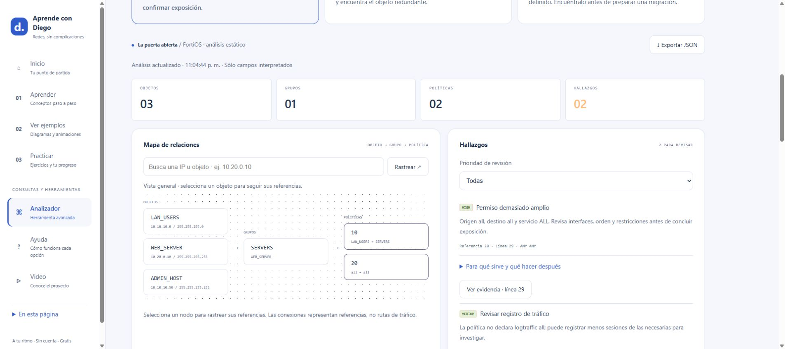
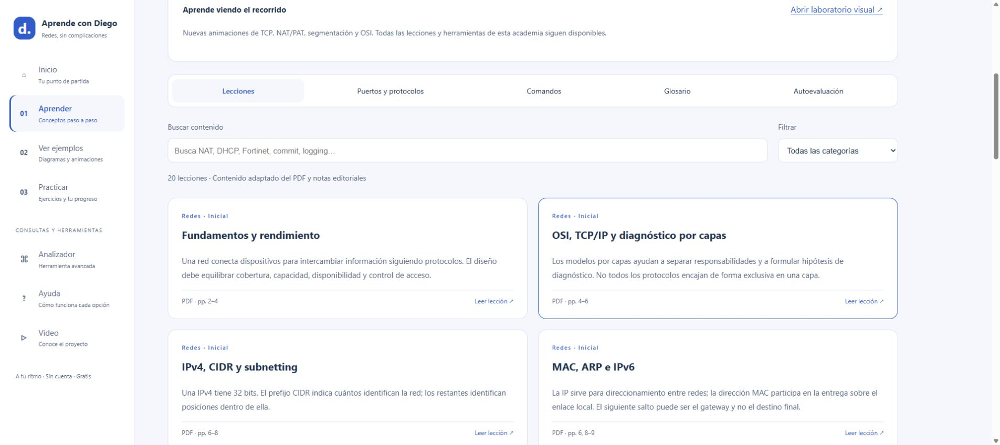

# ◈ Firewall Detective

**Follow the rule. Find the story.**

[Repositorio](https://github.com/DiegoEsteban20/firewall-detective) · [Pruebas automáticas](https://github.com/DiegoEsteban20/firewall-detective/actions)

Laboratorio interactivo para investigar configuraciones de firewall, entender referencias de IPs y practicar revisiones de políticas **sin hardware ni credenciales**.



**Estado:** v0.2.0 · laboratorio local · subconjunto FortiOS · escenarios sintéticos. PAN-OS y las conexiones a APIs de equipos todavía no están implementados.

## Inicio rápido

Requiere **Node.js 22 o posterior**. Sin dependencias de ejecución ni claves de API.

```sh
node server.js
```

Abre **http://127.0.0.1:3000**. En Windows puedes ejecutar `start-windows.cmd`. También se admite `npm start`.

La **[guía integrada](http://127.0.0.1:3000/guide)** explica el propósito de cada herramienta y qué hacer después de un hallazgo. La dirección funciona cuando el servidor está encendido.

## Recorrido inicial

1. Elige **La puerta abierta** y abre el hallazgo `ANY_ANY`.
2. Lee qué detecta, qué significa y qué verificar después. Pulsa **Ver evidencia**.
3. Busca `10.20.0.10` para explorar el objeto, su grupo y las políticas que lo referencian.
4. Cambia `service "ALL"` por `service "HTTPS"` en la política 20 del editor.
5. Analiza y compara contra la versión anterior: revisa el campo modificado.
6. Exporta el reporte JSON del análisis vigente.

Cambiar un criterio no confirma que una política sea segura. El proyecto muestra pistas para revisión y declara lo que no evalúa.

## Herramientas y propósito

| Herramienta | Para qué sirve |
| --- | --- |
| Tres investigaciones | Practicar exposición aparente, objetos duplicados y referencias ausentes |
| Explorador | Rastrear objetos y grupos que llevan a políticas |
| Búsqueda IPv4 | Encontrar pertenencia a subnet y referencias transitivas |
| Tabla de relaciones | Ver cada referencia explícita y el campo que la contiene |
| Inventario de políticas | Revisar interfaces, direcciones, servicios, acción y estado |
| Hallazgos explicados | Entender criterio, evidencia, prioridad, próximos pasos y límites |
| Editor local | Probar cambios de texto sin tocar un dispositivo |
| Comparación | Detectar cambios de campos y orden relativo de políticas comunes |
| Reporte JSON | Conservar el análisis vigente y sus advertencias |
| Centro de ayuda | Consultar ocho capítulos, conceptos y catálogo de criterios |
| API HTTP propia | Automatizar los análisis desde scripts con JSON |

## Documentación

- **[Manual de uso](docs/USER_GUIDE.md):** instalación, recorrido, módulos, criterios y solución de problemas.
- **[Contrato API](docs/API.md):** rutas, tipos, respuestas, errores y ejemplo en PowerShell.
- **[Arquitectura](docs/ARCHITECTURE.md):** módulos, modelo, algoritmos y decisiones.
- **[Seguridad](SECURITY.md):** datos, controles y límites de operación.
- **[Contribuciones](CONTRIBUTING.md):** cómo extender el proyecto con casos reproducibles.
- **[Validación](docs/VALIDATION.md):** pruebas y alcance de las verificaciones.
- **[Historial](CHANGELOG.md):** cambios de cada versión.
- **[Publicación en GitHub](docs/GITHUB_RELEASE.md):** presentación y pasos para publicar.

La guía en `/guide` no necesita recursos externos y comparte sus explicaciones con el panel de hallazgos.

## Academia de redes y ciberseguridad

Abre **http://127.0.0.1:3000/academy** para estudiar el material adaptado de la *Guía de Redes y Ciberseguridad* de @DiegoMolina, aportada para este proyecto:

- 20 lecciones de redes, seguridad, fabricantes y operación, con búsqueda, filtros, ejemplos y práctica.
- Referencias de puertos y protocolos, comandos por plataforma y glosario.
- Diez preguntas de autoevaluación con explicación y enlace a la lección.
- Páginas de origen por tema, notas de adaptación y referencias primarias.

El PDF original no se distribuye. La academia documenta ambos fabricantes, pero no amplía el soporte del parser a PAN-OS. Los comandos son texto de consulta y no se ejecutan. Consulta [procedencia y criterio editorial](docs/SOURCE_NOTES.md).



## API

| Método | Ruta | Entrada |
| --- | --- | --- |
| GET | `/api/health` | Sin cuerpo |
| GET | `/api/cases` | Sin cuerpo |
| POST | `/api/analyze` | `{ "config": "...", "query": "10.20.0.10" }` |
| POST | `/api/compare` | `{ "before": "...", "after": "..." }` |

POST requiere `Content-Type: application/json`; máximo 1 MB por solicitud. `query` es opcional. Los casos incluyen soluciones porque están diseñados para aprender.

```js
const base = 'http://127.0.0.1:3000';
const cases = await fetch(`${base}/api/cases`).then(response => response.json());
const response = await fetch(`${base}/api/analyze`, {
  method: 'POST',
  headers: { 'Content-Type': 'application/json' },
  body: JSON.stringify({ config: cases[0].config, query: '10.20.0.10' })
});
if (!response.ok) throw new Error(`HTTP ${response.status}`);
console.log((await response.json()).search);
```

## Compatibilidad y límites

Parser educativo para bloques **planos y completos** `config firewall address`, `config firewall addrgrp` y `config firewall policy`, de un único ámbito. Las opciones no evaluadas generan advertencias y se omiten del modelo. Los bloques ajenos, anidamientos, cierres incompletos e identificadores duplicados se rechazan.

La pertenencia a redes sólo interpreta `set subnet` con IPv4 y máscara decimal contigua. No interpreta VDOM, IPv6, FQDN, rangos, exclusiones, VIP/DNAT, perfiles, grupos dinámicos ni sintaxis avanzada de escape. No admite backups completos con otros bloques.

Las heurísticas `ANY_ANY`, `LOG_REVIEW`, `WAN_REVIEW`, `DUPLICATE` y `UNRESOLVED` no calculan conectividad, exposición efectiva, NAT, rutas, horarios o coincidencia de sesiones. Un archivo parcial puede producir referencias ausentes legítimas.

El explorador usa columnas de dependencias y tabla de referencias; no representa una topología física. Las políticas con `all` se listan como contexto universal separado, sin inferir su aplicabilidad.

La comparación semántica sólo evalúa campos interpretados. Informa cambios relativos de orden entre políticas comunes, sin validar su efecto operativo. La comparación textual preserva multiplicidad de líneas, no posiciones.

**No se ha validado contra equipos reales.** No existe afiliación ni certificación de fabricantes.

## Privacidad y ejecución

El servidor escucha en `127.0.0.1`. Procesa en memoria, sin base de datos, telemetría ni llamadas externas. No guarda configuraciones. La página conserva su estado hasta recargar; los reportes descargados permanecen en el disco del usuario y pueden incluir IPs internas, nombres y comentarios.

Usa datos sintéticos al compartir. No incluye autenticación ni controles de una plataforma multiusuario: mantén el servicio local.

## Docker

```sh
docker build -t firewall-detective .
docker run --rm -p 127.0.0.1:3000:3000 firewall-detective
```

El contenedor escucha internamente en todas sus interfaces; el mapeo anterior limita el puerto al loopback del host.

## Desarrollo y pruebas

```sh
node --test
```

Las pruebas cubren heurísticas, referencias transitivas, ciclos, IPv4, estructura, campos omitidos, comparación y contrato HTTP. GitHub Actions está configurado para Node.js 22 y 24; su ejecución remota se verificará después de publicar.

```text
firewall-detective/
├── .github/              CI y plantillas
├── docs/                 Manual, API y arquitectura
├── lib/                  Parser y casos sintéticos
├── public/               Interfaz y centro de ayuda
├── test/                 Pruebas automatizadas
├── server.js             API y servidor local
├── start-windows.cmd     Lanzador para Windows
├── Dockerfile
└── package.json
```

## Próximas etapas

- [ ] Adaptador XML PAN-OS con fixtures y pruebas de ámbitos.
- [ ] Modelo normalizado entre fabricantes.
- [ ] Más tipos de direcciones y ámbitos FortiOS.
- [ ] Grafo con aristas individuales y navegación de caminos.
- [ ] Conectores de lectura a APIs reales, validados en laboratorio.

## Licencia

[MIT](LICENSE). Proyecto independiente de aprendizaje y revisión documental.
