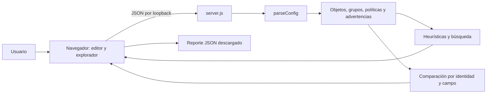

# Arquitectura y decisiones

## Objetivo técnico

### Versión web independiente

La interfaz importa el analizador y los casos como módulos de navegador. No realiza solicitudes de análisis. `scripts/build-static.js` genera `docs/` con rutas relativas para el subdirectorio de Pages, una CSP en HTML y un service worker que cachea sólo recursos estáticos conocidos. El backend del diagrama siguiente queda como API opcional para scripts locales; no interviene en el análisis de la interfaz.

Una aplicación local, reproducible y sin dependencias de ejecución que mantenga separadas la interpretación de configuración, las heurísticas, el transporte HTTP y la interfaz. La versión 0.2.0 es un laboratorio educativo, no una plataforma de auditoría certificada.

## Módulos

| Archivo | Responsabilidad |
| --- | --- |
| `server.js` | Lista permitida de rutas estáticas, límites de solicitud, validación de JSON y transporte |
| `lib/analyzer.js` | Parser plano, evidencia de línea, hallazgos, expansión de grupos, búsqueda y comparación |
| `lib/cases.js` | Tres casos deterministas, sin información real |
| `public/app.js` | Estado de interacción, renderizado escapado, control de resultados desactualizados |
| `public/help.js` | Explicaciones reutilizadas en el catálogo y los hallazgos |
| `public/guide.js` | Navegación y búsqueda del manual |
| `test/` | Comportamiento del modelo y contrato HTTP |

## Modelo

Los identificadores proceden de `edit`. Cada elemento contiene `name` y `line`. Los campos interpretados se conservan como listas de texto. `set name` se almacena como `label` para evitar sobrescribir el identificador de la política.

No se conservan campos arbitrarios: las opciones fuera de la lista permitida generan advertencias y no se incluyen en el modelo. Esto limita el alcance de la comparación semántica y evita copiar automáticamente campos desconocidos a los reportes.

## Algoritmos

- Parser: recorrido por líneas y validación de cierres básicos. Rechaza anidamientos y ámbitos múltiples con IDs repetidos.
- Hallazgos: comprobaciones deterministas del subconjunto, con cinco códigos estables.
- Búsqueda: coincidencia textual o pertenencia IPv4; expansión iterativa de grupos hasta alcanzar un punto fijo. El conjunto de visitados evita bucles.
- Comparación textual: resta de multiconjuntos de líneas; conserva multiplicidad, no posición.
- Comparación semántica: mapas por categoría e identificador; diferencias en campos soportados. Excluye números de línea para no confundir desplazamientos con cambios.
- Orden: compara la secuencia relativa de políticas presentes en ambas versiones. Inserciones y eliminaciones se informan por separado; no se valida el efecto del orden sobre paquetes.

La expansión de grupos y la comparación de órdenes pueden ser cuadráticas. El límite de solicitud reduce el tamaño de entrada, pero no convierte estos algoritmos en una solución para configuraciones masivas.

## Estado y consistencia

El editor es la fuente de configuración. Cualquier edición invalida los resultados y deshabilita exportar. Cada análisis lleva un contador local: una respuesta anterior no puede reemplazar una posterior. La búsqueda vuelve a analizar la configuración actual.

Los casos y soluciones son públicos en la API; el modo desafío es aprendizaje, no un sistema de examen. Las pistas describen el fixture original y no cambian al editarlo.

## Superficie HTTP

Archivos accesibles por lista fija; no se construyen rutas de disco desde entradas del usuario. POST requiere objeto JSON, tamaño máximo y tipos básicos. Origin se comprueba si existe; no equivale a autenticación. No hay operaciones de red hacia firewalls ni ejecución de comandos.

## Biblioteca educativa

`public/academy-data.js` contiene las lecciones, referencias de servicios, comandos, glosario y preguntas. `public/academy.js` proporciona búsqueda normalizada, filtros, navegación por fragmentos de URL y feedback de autoevaluación. `/academy` se sirve con la misma lista fija de archivos y CSP que el laboratorio.

La academia no añade endpoints de ejecución ni solicita credenciales. Las respuestas del cuestionario viven en memoria del navegador. La atribución, páginas de origen y modificaciones editoriales se documentan en `docs/SOURCE_NOTES.md`; el PDF original queda fuera del repositorio. Aprender sobre PAN-OS no modifica la capacidad del parser FortiOS.

## Evolución

Antes de soportar PAN-OS se requiere un parser XML mantenido, límites de profundidad y entidades, modelo de ámbitos, fixtures y pruebas de referencias. Antes de conectar APIs reales se requiere gestión de credenciales, TLS, permisos de lectura y laboratorio para validar versiones. Estas integraciones no están simuladas como si fueran reales.
